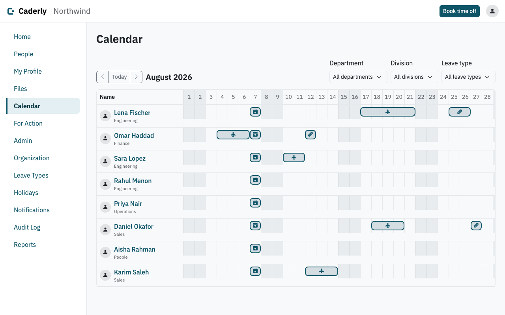
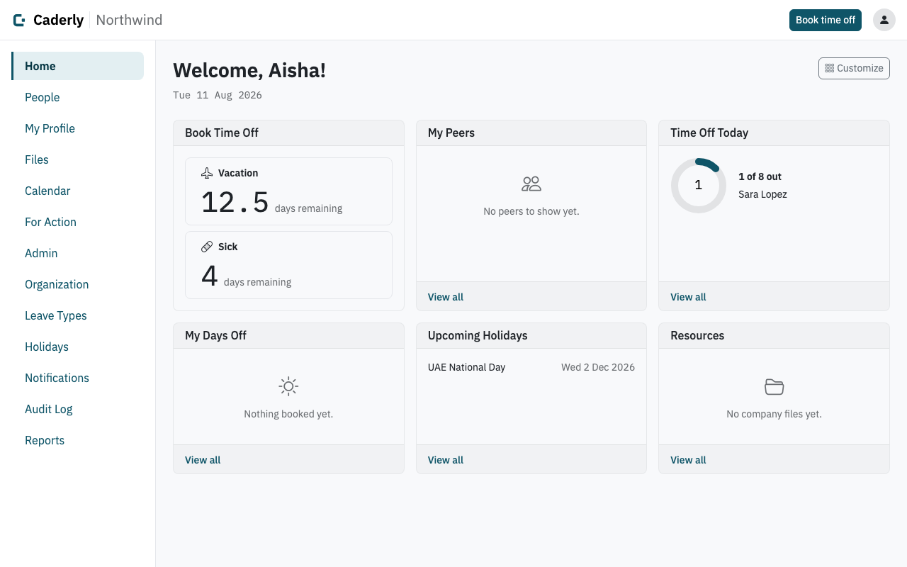
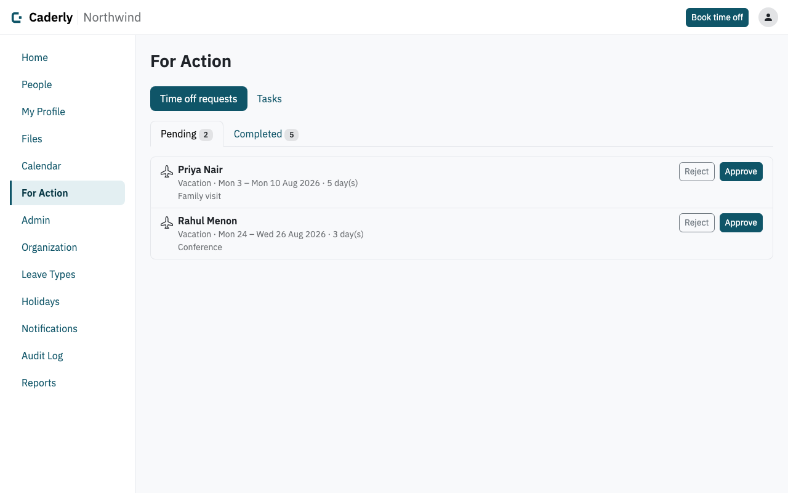
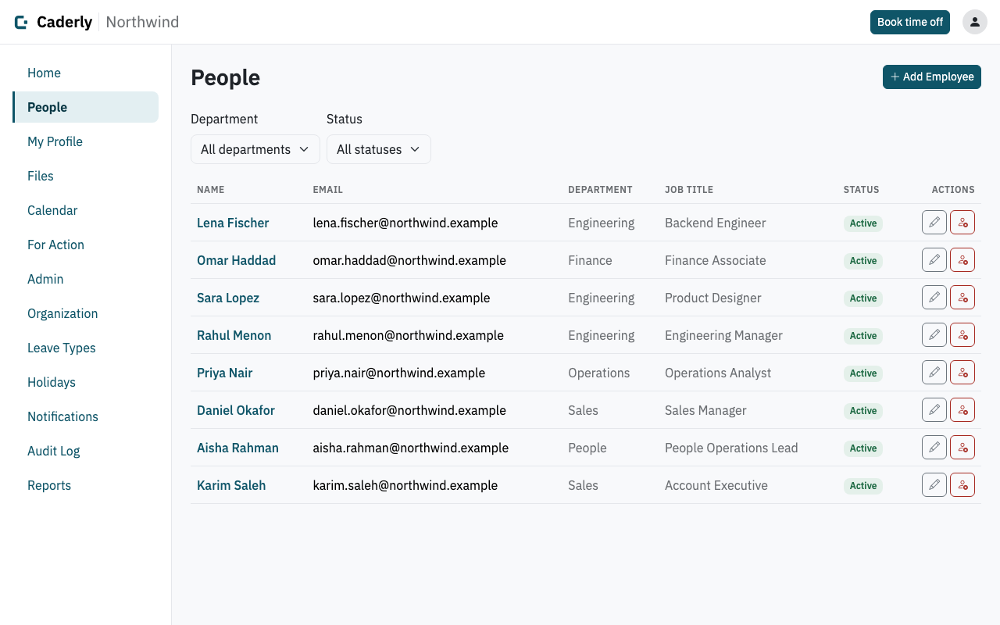
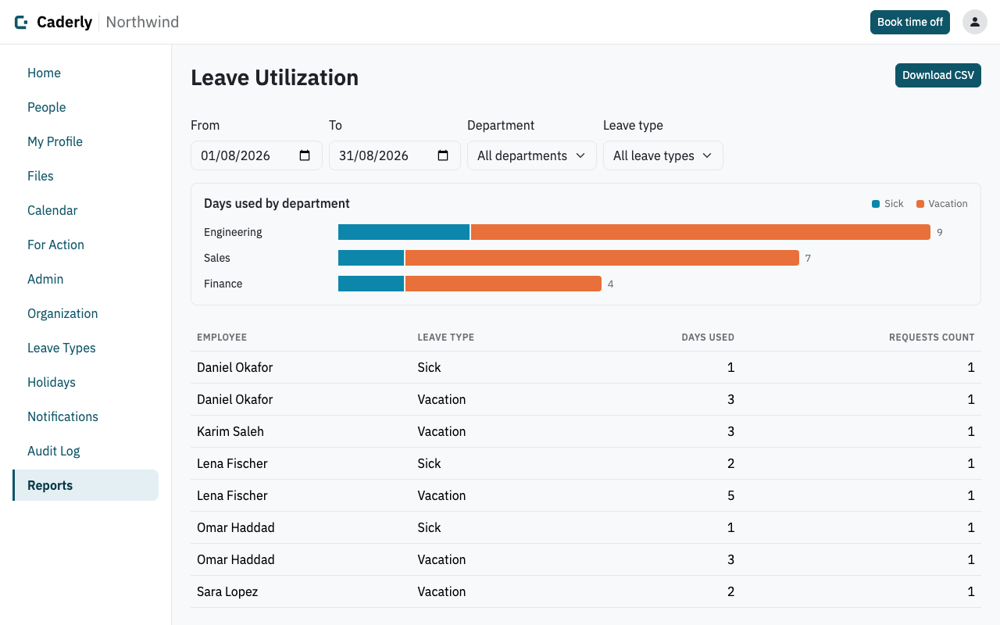
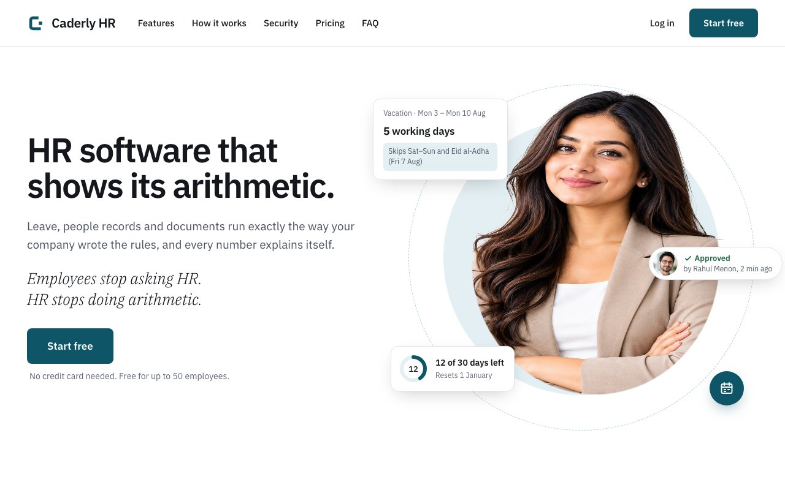

# Caderly HR

A multi-tenant HR information system with leave management. Each company gets its own workspace on its own subdomain (`acme.example.com`), configures its own leave types, weekends, holidays and org structure, and never sees another company's data.

> **Status:** in active development and used by its first customer. This is a proprietary product: the source is visible, but it is **not open source** and no licence to use, copy or deploy it is granted. All rights reserved.



<table>
  <tr>
    <td></td>
    <td></td>
  </tr>
  <tr>
    <td></td>
    <td></td>
  </tr>
  <tr>
    <td colspan="2"></td>
  </tr>
</table>

*Screenshots use fictional data. To refresh them (and the public site's product screenshots), run
`./mvnw test -Dtest=SiteScreenshotsE2ETest -DsiteScreenshots=true` (needs `cwebp` on the PATH).*

## What it does

- **Workspaces:** every company on its own subdomain, isolated in the database. A public site lets a visitor create a workspace after verifying their email.
- **People:** employee profiles with encrypted sensitive fields, divisions and departments, manager history, invitations and onboarding.
- **Time off:** configurable leave types, balances and holidays; leave requests with manager approval; a team calendar and a personal iCal feed.
- **Documents:** company files and per-employee documents with strict upload validation.
- **Home dashboard:** a per-user customisable home with an inbox of actions to take.
- **Notifications and audit:** reliable email through a durable outbox, and an audit log of every write.
- **Reports:** balances, leave utilisation (stacked bar per department) and headcount (monthly line), with CSV export.
- **Operator console:** a separate Super Admin console (own login, IP allowlist) for provisioning, suspending and supporting workspaces.

The full specification is in [`docs/Caderly_PRD.md`](docs/Caderly_PRD.md) and the delivery plan in [`docs/Caderly_Implementation_Plan.md`](docs/Caderly_Implementation_Plan.md).

## Tech stack

Java 25 · Spring Boot 4.1 · Spring Security 7 · PostgreSQL 17 · Hibernate 7 · Flyway · Thymeleaf with htmx, Alpine.js and Bootstrap 5 (server-rendered, no SPA) · Caffeine · Docker with Caddy for deployment. Testing uses JUnit 5, Testcontainers, ArchUnit and Playwright.

## How it is built

- **A modular monolith** with one package per domain module (`people`, `timeoff`, `calendar`, ...). Modules talk to each other through facades, and package cycles are forbidden by an ArchUnit test.
- **Tenant isolation in two layers.** Hibernate filters every query by tenant (`@TenantId`), and PostgreSQL row-level security enforces the same rule underneath, so a missed filter in code still cannot leak a row. The tenant comes from the subdomain.
- **Side effects go through an outbox.** Email is written to a table in the same transaction as the change that caused it and sent by a scheduled dispatcher, with retries.
- **Security by default.** Deny-by-default routes, CSRF on, a strict CSP with no inline scripts, BCrypt passwords, encrypted sensitive columns, rate limiting and lockout on sign-in. The rules and how they are enforced are in [`CLAUDE.md`](CLAUDE.md) section 6.

Design decisions are recorded as short ADRs in [`docs/adr/`](docs/adr/).

## Run it locally

You need Java 25 (for example `sdk install java 25-tem` with [SDKMAN](https://sdkman.io/)), PostgreSQL 17 and Docker (for the tests and the local mail inbox).

1. **Create the database and role:**
   ```bash
   createuser caderly --pwprompt
   createdb caderly -O caderly
   ```
2. **Configure:** `cp .env.example .env`, then set `DB_PASSWORD` (and `DB_USER` if you chose another role) and `CADERLY_EMPLOYEE_ENCRYPTION_KEY` (`openssl rand -base64 32`; keep it stable once real data is encrypted with it).
3. **Start a local mail inbox** (all outgoing mail is caught here, nothing is delivered):
   ```bash
   docker run -d -p 1025:1025 -p 8025:8025 axllent/mailpit
   ```
   Read the mail at http://localhost:8025.
4. **Run the app:**
   ```bash
   export $(grep -v '^#' .env | xargs)
   ./mvnw spring-boot:run
   ```
   `spring-boot:run` turns on the `dev` profile. Anywhere else (an IDE run configuration, a packaged jar) set `SPRING_PROFILES_ACTIVE=dev`; there is deliberately no default profile. Flyway creates the schema on first start.
5. **Open it:**
   - Public site and sign-up: http://localhost:8080
   - Seeded dev workspace: its slug and admin credentials are the `caderly.dev.*` defaults in `bootstrap/DevDataSeeder.java`, and they exist only under the `dev` profile (sign in at `http://<slug>.localhost:8080/login`). Browsers resolve `*.localhost` to your machine automatically.
   - Self-serve sign-up is open in dev; its confirmation email arrives in Mailpit.

## Tests and quality checks

```bash
./mvnw test      # unit and integration tests (starts its own PostgreSQL through Testcontainers)
./mvnw verify    # everything above, plus the browser tests and the coverage report
```

- Docker must be running. The first `verify` downloads a Chromium build for Playwright.
- The coverage report is written to `target/site/jacoco/`.
- PMD runs on `verify` in report-only mode. SpotBugs is configured but not run yet because its current release cannot read Java 25 class files.
- Continuous integration runs `./mvnw verify` on every pull request ([`.github/workflows/ci.yml`](.github/workflows/ci.yml)).

## Project layout

```
com.caderly.caderlyhr
|-- identity  tenant  org  people  timeoff  calendar  documents
|-- notifications  audit  reports  storage  security
|-- web (server-rendered controllers, including the public site)
|-- api (REST under /api/v1)  superadmin  signup  bootstrap  common
```

The rules for this layout, the multi-tenancy contract and the testing rules are in [`CLAUDE.md`](CLAUDE.md).

## Documentation

| Document | What it is |
|---|---|
| [`docs/Caderly_PRD.md`](docs/Caderly_PRD.md) | Product requirements |
| [`docs/Caderly_Implementation_Plan.md`](docs/Caderly_Implementation_Plan.md) | Phased delivery plan with definitions of done |
| [`docs/adr/`](docs/adr/) | Architecture decision records |
| [`docs/UI_Guidelines.md`](docs/UI_Guidelines.md) and [`docs/design-system/`](docs/design-system/) | UI conventions, tokens and brand assets |
| [`INSTALL.md`](INSTALL.md) | Installing on a Debian server |
| [`CLAUDE.md`](CLAUDE.md) | Engineering conventions and standing rules |

The day-to-day working notes for the current phase are kept on the maintainer's machine and are not part of the repository.

## Deploying

Production runs as two containers, the app and Caddy, with PostgreSQL installed natively on the host. See [`INSTALL.md`](INSTALL.md) for the full procedure. Configuration is entirely through environment variables; [`.env.production.example`](.env.production.example) lists them all.

## Contributing

Work happens on one branch per sub-phase, with conventional-commit messages and a pull request checklist; see [`CLAUDE.md`](CLAUDE.md) section 9.
